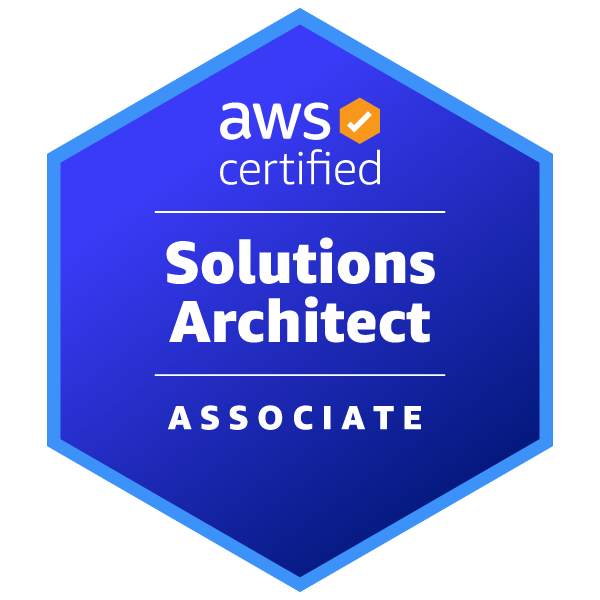
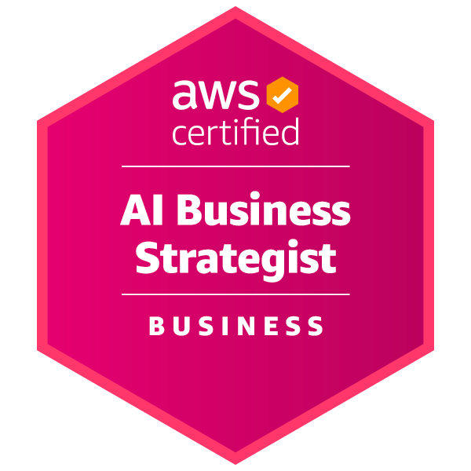

#  Hi there 👋

**`Software Engineering | Cloud Application Architect | 5x AWS Certified`**

I'm Leoni, a Cloud Application Architect and Software Engineer focused on designing and developing scalable cloud solutions. I help large organizations adopt cloud technologies, modernize their applications, and build reliable digital products — especially solutions powered by Generative AI.

With a background in Full Stack development, I combine software engineering, cloud architecture, data analysis, and process automation to solve complex business challenges and deliver measurable value. I have contributed to development and strategic communication projects for a major stock exchange, a Fortune 500 financial institution, a global logistics company, a leading energy company and more.

I'm also an undergraduate student in Computer Science at the Federal University of ABC (UFABC) and hold five AWS certifications. I continuously explore new technologies, follow industry trends, and strengthen my problem-solving skills.

---

### 🧰 Languages and Tools

### 🎓 Certifications

<table>
  <tr>
    <td align="center">
      <a href="https://www.credly.com/badges/ede51498-f030-46e0-ba9a-2148aacc46f1/public_url" title="View credential" target="_blank">
         
        <b>AWS Certified Developer - Associate</b>
      </a>
    </td>
    <td align="center">
      <a href="https://www.credly.com/badges/8f21d363-7814-4d82-a7f7-c2a2ad47ac89/public_url" title="View credential" target="_blank">
         
        <b>AWS Certified Solutions Architect - Associate</b>
      </a>
    </td>
    <td align="center">
      <a href="https://www.credly.com/badges/5ca3a461-75cc-462a-a1af-a9e4d4d0c2e6/public_url" title="View credential" target="_blank">
         
        <b>AWS Certified AI Business Strategist</b>
      </a>
    </td>
    <td align="center">
      <a href="https://www.credly.com/badges/375ff397-f65b-4a67-981e-290bf6eaec09/public_url" title="View credential" target="_blank">
         
        <b>AWS Certified AI Practitioner</b>
      </a>
    </td>
    <td align="center">
      <a href="https://www.credly.com/badges/b510b37f-1db3-4a7e-85db-cb854ed0629b/public_url" title="View credential" target="_blank">
         
        <b>AWS Certified Cloud Practitioner</b>
      </a>
    </td>
  </tr>
</table>
